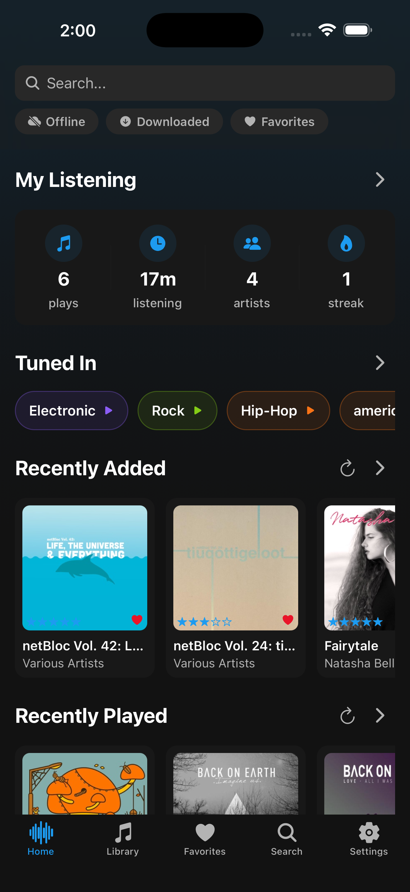
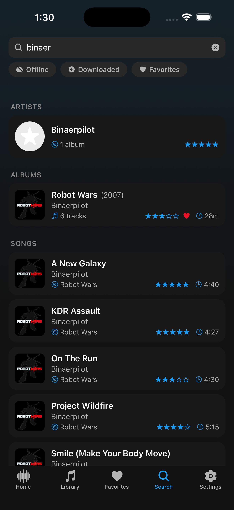
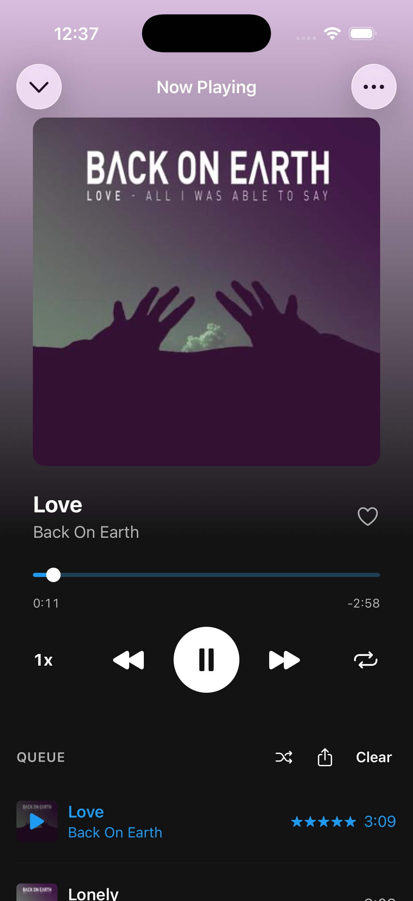
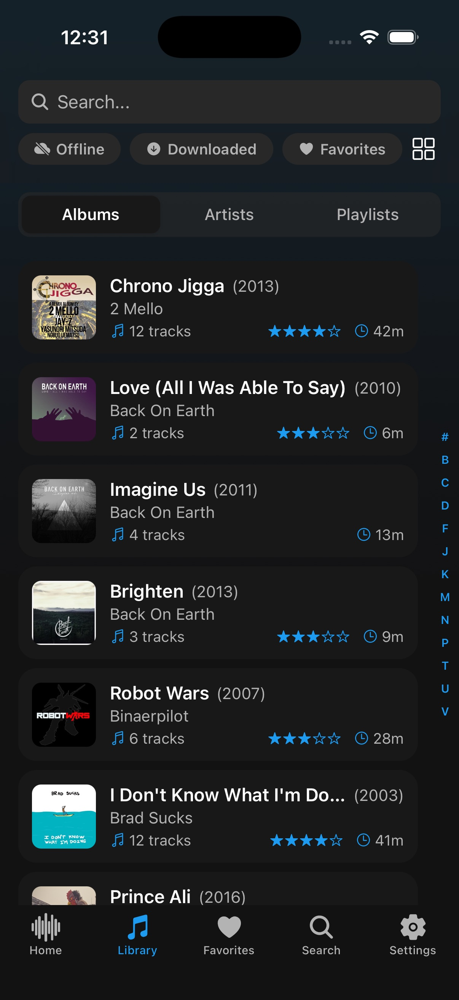
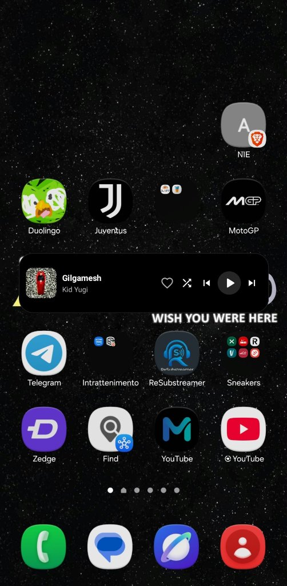
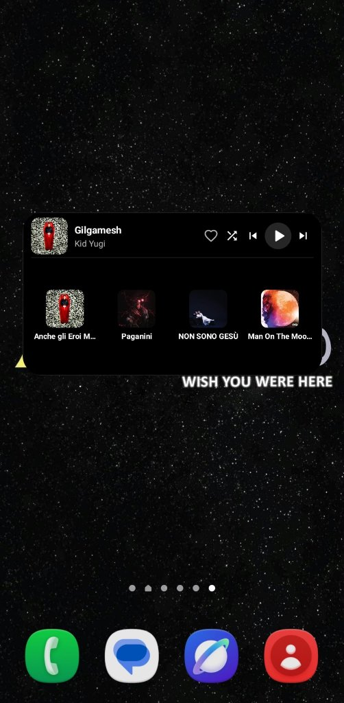

# ReSubstreamer 🎵

[](https://www.gnu.org/licenses/gpl-3.0)
[](https://reactnative.dev)
[](https://expo.dev)
[](https://www.typescriptlang.org)
[](#)
[](#)

A modern, ultra-high-performance, and bespoke **Subsonic & Navidrome** music client built with **React Native**, **Expo**, and **Native C++/Kotlin/Swift modules**. 

ReSubstreamer is a ground-up modernization of [Substreamer](https://github.com/ghenry22/substreamer) by Gaven Henry (licensed under GPL-3.0), redesigned from the core to deliver a fluid, native, and **Spotify-like** mobile music experience for self-hosted audio enthusiasts.

---

## 📸 Screenshots & Showcase

<div align="center">

| Home Dinamica | Ricerca Spotify-Like | Now Playing Player |
| :---: | :---: | :---: |
|  |  |  |
| *Home dinamica con filtri e recenti* | *Top Hit, brani compatti e caroselli* | *Metadati interattivi e sfondi dinamici* |

| Coda Gestuale (Up Next) | Widget Compatto (4x1 / 4x2) | Widget Espanso (4x2 / 4x3) |
| :---: | :---: | :---: |
|  |  |  |
| *Coda partizionata con drag-and-drop* | *Widget 4x1 OLED con controlli rapidi* | *Widget 4x3 con griglia suggeriti/recenti* |

</div>

---

## ✨ Key Features & Highlights

### ⚡ Zero-Latency "Play-First, Fetch-Later" Engine
- **Instant Playback Trigger**: Tapping any song, album, or artist begins playback immediately in sub-50ms without full-screen blocking spinners or modal overlays.
- **Background Smart Queue Resolution**: Similar tracks and radio queues ("Riproduci simili") are fetched asynchronously in the background while the selected song is already playing.
- **Offline & Connectivity Resilient**: Transparent automatic fallback to the local SQLite offline cache when offline or when network latency occurs. Non-intrusive bottom toast notifications communicate status without interrupting navigation.

### 📱 Android Native Home Screen Widget
- **100% Native Media3 Connection**: Directly binds to `PlaybackService` (`MediaLibraryService`) via native AndroidX `MediaController` for zero-latency playback sync, instant track titles, and immediate response.
- **Dual Responsive Layout**:
  - **Compact (4x1 / 4x2)**: Ultra-sleek single-row layout with album art, interactive track metadata, favorite toggle, shuffle, and transport controls.
  - **Expanded (4x2 / 4x3)**: Automatically expands to display a dedicated 4-slot grid of recently played and suggested albums/songs, clickable for one-touch playback.
- **Cold-Start Playback Recovery**: Tap play on the home screen after a reboot or device idle period — the native receiver boots an optimized Headless JS service, restores the persisted queue, and resumes music seamlessly.
- **Dynamic Theming & OLED Pure Black**: Choose between cover-derived dynamic palettes (using AndroidX Palette extraction) or pitch-black `#000000` Pure OLED mode.
- **Customizable Shuffle Modes**: Configure the widget shuffle button directly in app settings:
  - *Toggle Queue*: Shuffles the active queue.
  - *All Songs*: Fetches and randomizes library tracks.
  - *Starred Songs*: Plays a shuffle of your favorite songs.
  - *Downloaded Only*: Instant offline randomized playback of stored audio.

### 🔍 Spotify-Style Hierarchical Search
- **Smart "Top Hit" (Risultato Migliore)**: Automatically promotes the best match (artist with circular avatar and verified badge, or top song) with direct one-touch play.
- **Compact & High-Density Song List**: Clean 48x48 artwork song rows without clutter, integrated with intuitive gestures (swipe right to queue, swipe left for favorites/options).
- **Horizontal Carousels**: Dedicated horizontal carousels for Artists (circular avatars) and Albums (square covers with single-line labels) to quickly drill down into catalogs.
- **Focused Navigation**: Search input is exclusively located on the dedicated Search tab, preserving clean headers across Home, Library, and Favorites.

### 🎛️ Fluid 60/120 FPS Player & Gesture-Driven Queue
- **Interactive Inline Metadata**: The `Artist • Album` header is interactive: tap to navigate directly to the album or artist. For multi-artist and collaboration tracks (featuring), an interactive pop-up selector lets you pick which artist to explore.
- **Gesture-Locked Mini-Player**: Smooth horizontal swipe gesture with springless magnetic snap deceleration to skip tracks without accidental bottom sheet drags.
- **Partitioned Queue Management**: Clear visual hierarchy separating *Now Playing*, *User Queue*, and *Context / Album Queue*.
- **1:1 Scroll-to-Dismiss Queue Sheet**: Drag-down dismissal with coordinated velocity physics, seamless list scrolling, swipe-to-remove rows, and bounded reordering.

### 💾 Local-First Architecture & Offline Caching
- **High-Performance SQLite Storage**: Powered by `@op-engineering/op-sqlite` and Drizzle ORM for lightning-fast database queries, metadata indexing, and offline filtering.
- **Intelligent Media Caching**: Automated song preloading, custom lookahead cache management, and download managers with status indicators.
- **Listening Stats (My Listening)**: Fully local, private tracking of playback history, play counts, and listening analytics.
- **Custom Native Modules**:
  - `expo-async-fs`: High-throughput background streaming and file caching.
  - `expo-image-colors`: Hardware-accelerated color palette extraction.
  - `expo-ssl-trust`: Support for self-signed certificates and custom CA configurations for home-lab servers.
  - `expo-backup-exclusions`: Prevents large music caches from bloating Android/iOS system backups.
  - `expo-move-to-back`: Smooth native backgrounding on system back gestures.

---

## 🛠️ Tech Stack & Architecture

| Layer | Technologies |
| :--- | :--- |
| **Framework** | [React Native 0.76+](https://reactnative.dev), [Expo SDK 57](https://expo.dev) ([Expo Router v4](https://docs.expo.dev/router/introduction/)) |
| **Language** | [TypeScript 5](https://www.typescriptlang.org/) |
| **State Management** | [Zustand](https://github.com/pmndrs/zustand) (sliced stores with selective subscriptions) |
| **Database & ORM** | [@op-engineering/op-sqlite](https://github.com/OP-Engineering/op-sqlite) + [Drizzle ORM](https://orm.drizzle.team/) |
| **Audio Engine** | `react-native-queue-player` (C++ Nitro Modules, AndroidX Media3 / ExoPlayer, AVQueuePlayer) |
| **Gestures & Animations** | `react-native-reanimated 3`, `react-native-gesture-handler 2` (worklet-based 60/120fps UI threads) |
| **Native Integration** | Custom Kotlin (Android AppWidget, Media3 Session, BroadcastReceivers) and Swift Modules |
| **API Compatibility** | Subsonic API v1.16.1+, Navidrome, OpenSubsonic, Gonic, LMS, Airsonic |

---

## 🚀 Getting Started

### Prerequisites

- **Node.js**: `18.x` or `>= 20.x`
- **Package Manager**: `npm` or `pnpm`
- **JDK**: Java Development Kit 17 (`JAVA_HOME`)
- **Android SDK**: Android Studio with Platform Tools and API 34+ (`ANDROID_HOME`)

### Installation

```bash
# 1. Clone the repository
git clone https://github.com/monti8403/ReSubstreamer.git
cd ReSubstreamer/ReSubstreamer

# 2. Install dependencies
npm install
```

### Running Tests

```bash
# Run unit and integration tests (Jest)
npm test

# Run TypeScript type check
npx tsc --noEmit
```

### Running & Compiling for Android

> [!IMPORTANT]
> Because ReSubstreamer utilizes native C++ Nitro modules, custom Android permissions, and a native Android AppWidget, **Expo Go is not supported**. You must run a native build.

```bash
# Debug Build & Run on connected device or emulator
npx expo run:android

# Or build a Release APK via Gradle
cd android
./gradlew assembleRelease

# Install Release APK directly onto a connected device
./gradlew installRelease
```

---

## 📄 License & Acknowledgements

- **License**: Licensed under the **[GNU General Public License v3.0 (GPL-3.0)](LICENSE)**.
- **Original Project**: Built upon the foundational work of [Substreamer](https://github.com/ghenry22/substreamer) by **Gaven Henry**. We express gratitude for the original open-source initiative that made this modernization possible.
- **Artwork & Logos**: All trademarks, logos, and brand names are the property of their respective owners.
